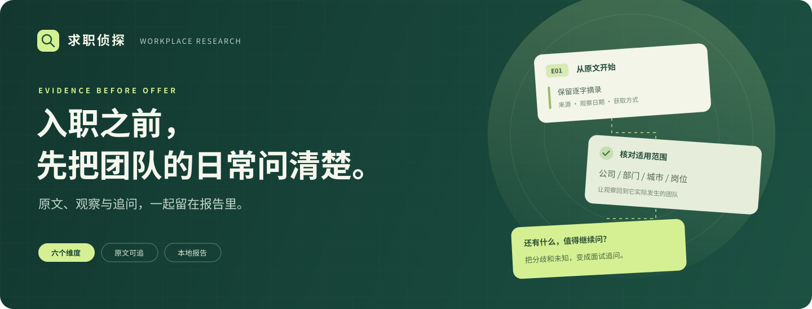
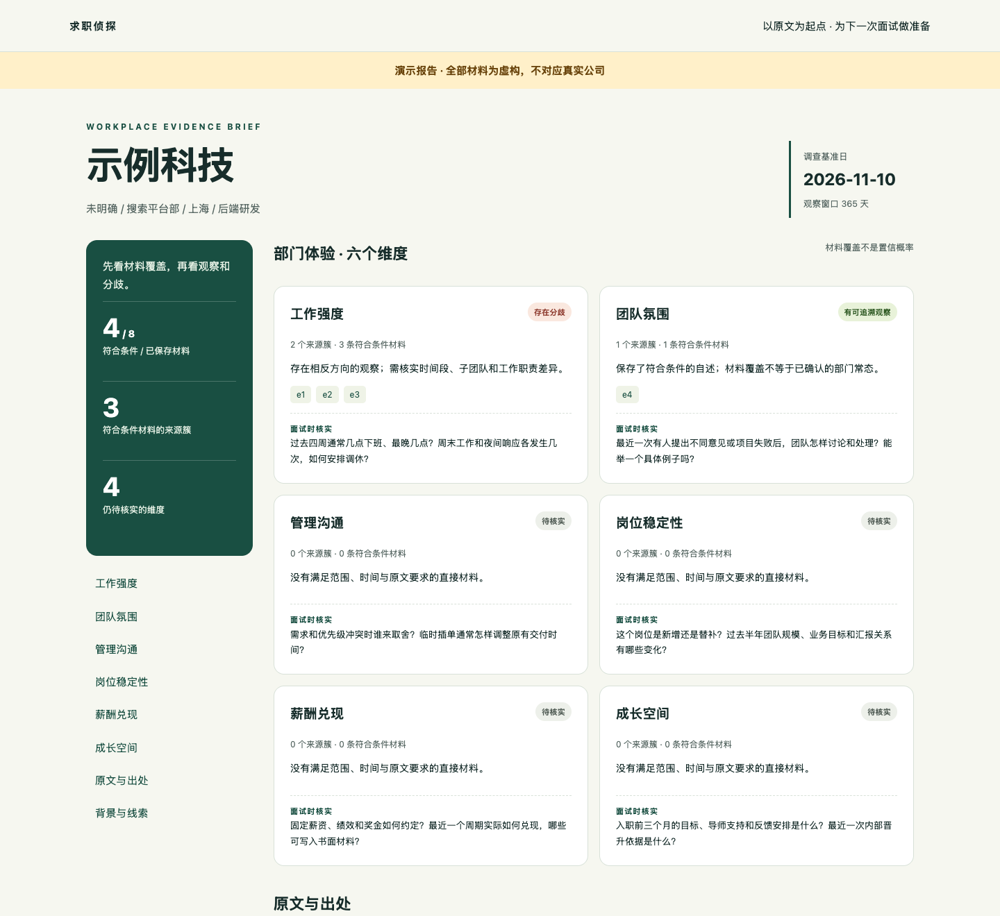
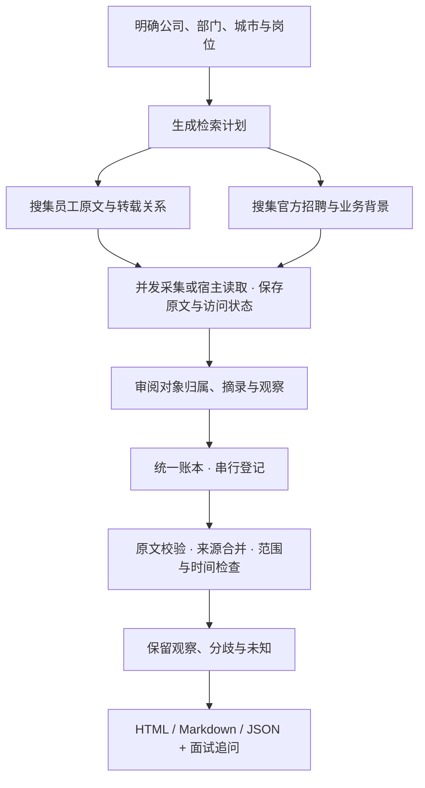

<p align="center">
  
</p>

<h1 align="center">求职侦探 Job-Sherlock · 公司与部门反向背调</h1>

<p align="center">
  围绕你即将加入的团队，整理工作体验材料，生成一份能追到原文的调查报告。
</p>

<p align="center">
  
</p>

<p align="center">
  <a href="#preview">看报告</a> ·
  <a href="#quick-start">30 秒体验</a> ·
  <a href="#use-skill">交给 Agent 调查</a> ·
  <a href="#workflow">工作流程</a> ·
  <a href="#faq">常见问题</a>
</p>

---

**求职侦探把调查对象落到公司、部门、城市和岗位，把每条观察连回原文。** 哪些材料适用、哪些已经过时、哪里出现分歧，都在报告中展开；还没查清的部分，变成下一次面试可以直接问的问题。

<a id="preview"></a>

## 先看一份报告

<p align="center">
  <a href="docs/assets/report-preview.png">
    
  </a>
</p>

<p align="center"><sub>由仓库内演示命令实际生成并截图；公司、人物与材料全部虚构。点击图片可查看大图。</sub></p>

这份演示保存了 **8 条材料**，其中 **4 条符合分析条件，合并为 3 个来源簇**。

| 报告里的结果 | 它意味着什么 |
| :--- | :--- |
| **工作强度 · 存在分歧** | 晚十点与晚六点下班的自述同时存在，继续核实子团队、时间段和职责差异 |
| **团队氛围 · 有可追溯观察** | 一位作者描述了允许不同意见的复盘经历，保留为一次具体观察 |
| **其余四项 · 待核实** | 现有材料不足以判断，报告给出对应的面试追问 |

每条观察都能展开查看**原文摘录、来源定位、观察日期和适用范围**。同一篇自述的转载合并计数；官方宣传、过时体验、其他团队材料和无法读取的搜索摘要留在背景区。

<a id="quick-start"></a>

## 从论坛查工作氛围与强度

```bash
python3 -m reverse_check channels
python3 -m reverse_check scan cases/target --limit 5 --timeout 20
python3 -m reverse_check report cases/target
```

案例先用 `init` 创建。`scan` 接入 V2EX 最近主题/指定主题与回复，并提供牛客、知乎、小红书的 OpenCLI 搜索及详情读取；OpenCLI 需要配置浏览器连接与平台会话。脉脉职言、OfferShow 的工作体验讨论目前仍需人工提供原文。扫描报告聚焦工作氛围与强度，不查询薪资；读取结果需要审阅后才能进入证据账本。参见 [论坛接入、限制和配置](docs/forum-scan.md)。

## 30 秒，跑出第一份报告

准备 **Python 3.11+**，在项目根目录运行，无需安装第三方运行包：

```bash
python3 -m reverse_check demo --out reports/first-look
```

用浏览器打开 `reports/first-look/report.html`。同一目录保留三个版本：

```text
reports/first-look/
├── report.html       # 浏览器阅读，含原文与面试追问
├── report.md         # 继续编辑或归档
├── report.json       # 复查完整证据和归类结果
└── case/             # 案例、原始材料与待执行检索计划
```

> 演示使用虚构材料，网络检索次数为 0。输出目录已有案例或报告时会保留原文件；重新演示请换一个目录。

## Offer 到手之后，还有这些事值得问清

| 你关心什么 | 调查时具体看什么 |
| :--- | :--- |
| **工作强度** | 近期下班时间、夜间响应、周末工作、上线与值班安排 |
| **团队氛围** | 不同意见怎样提出、失败怎样复盘、同事怎样协作 |
| **管理沟通** | 谁决定优先级、临时需求怎样处理、反馈怎样发生 |
| **岗位稳定性** | 新增还是替补、团队规模变化、业务与汇报关系调整 |
| **薪酬兑现** | 固定与浮动部分、绩效和奖金约定、实际兑现经历 |
| **成长空间** | 入职目标、导师支持、反馈周期、晋升的具体依据 |

<a id="use-skill"></a>

## 交给 Agent，调查你真正关心的团队

在 Codex 中打开本仓库，使用内置的 [reverse-check Skill](.agents/skills/reverse-check/SKILL.md)：

```text
使用 reverse-check，调查「目标公司 / 目标部门 / 上海 / 后端研发」。

重点看最近一年的加班、值班和团队沟通。
把原文来源、相反观察和访问受限的部分一起保存，
最后给我一份报告，以及下一轮面试应该追问的问题。
```

Skill 会使用**宿主已有的搜索能力**发现链接，再调用本地 `collect` 并发读取支持的公开原文；登录平台或需要浏览器渲染的内容使用宿主网页工具或用户材料。每次采集保留来源配置、响应快照、最终URL与状态。有子 Agent 工具时，员工材料与官方背景可分别搜集，最后汇总到同一个证据账本。

材料来自公开网页，也可以来自你提供的访谈笔记、招聘内容或已读取文本。需要登录、付费或无法访问的原文会被记为缺口；CLI 本身不内置搜索引擎或登录平台爬虫。公开原文采集可直接使用，抓到的文本须审阅后才能导入证据。

## 自己掌控每一步

**① 明确对象，生成检索计划**

```bash
python3 -m reverse_check init cases/target \
  --company '目标公司' --department '目标部门' \
  --city '上海' --role '后端研发'

python3 -m reverse_check plan cases/target
```

查看 `cases/target/queries.md`，执行检索并读取原文。检索计划包含六个维度的线索和面试问题。

**② 查看来源配置，并发保存已找到的原文**

```bash
python3 -m reverse_check sources
python3 -m reverse_check collect cases/target --urls /absolute/path/urls.json \
  --workers 4 --timeout 10
```

`urls.json` 是原文URL数组，例如 `["https://example.com/article"]`（示意地址，请替换）。来源注册表区分公开读取与人工读取，并为HTTP200登录页、验证码、403、429、超时等保留不同状态。

结果位于 `cases/target/collections/<本次ID>/`，含 `run.json`、响应快照、`sources.json` 和 `evidence-drafts.json`。草稿里的对象归属、日期、摘录与观察留空，**不能直接导入**。先逐条审阅并完成这些字段；采集记录本身会在报告中单独展示。详见 [公开来源采集](docs/collection.md)。

**③ 登记已审阅材料，生成报告**

按 [证据格式](docs/evidence-format.md) 整理一个 JSON 数组，再运行：

```bash
python3 -m reverse_check import cases/target --file /absolute/path/evidence-batch.json
python3 -m reverse_check report cases/target --out reports/target
```

导入时会检查摘录是否确实存在于保存文本中；一批材料里有任何一条格式不合格，整批不写入。同内容同 ID 重复导入不会重复登记。

<details>
<summary><strong>更多选项：业务线、主体别名、时间窗口与演练</strong></summary>

| 选项 | 用途 |
| :--- | :--- |
| `init --business-unit '业务线'` | 在部门之外，继续限定业务线 |
| `init --company-alias '已确认别名'` | 登记有依据的公司主体别名；可重复提供 |
| `init --as-of 2026-11-10` | 固定调查基准日；默认使用上海当天日期 |
| `init --lookback-days 365` | 调整观察窗口，默认 365 天 |
| `init --demo` | 用虚构材料手动演练，后续报告始终显示演示标识 |
| `plan --source nowcoder` | 生成指定来源的检索式；可重复提供 |
| `plan --sources FILE` / `collect --sources FILE` | 使用自己的本地来源注册表 |
| `collect --workers 4 --timeout 10 --max-bytes 1000000` | 控制并发数、连接/读取预算和正文大小 |
| `plan --force` / `report --force` | 明确覆盖已有的检索计划或报告 |

查看命令帮助：`python3 -m reverse_check --help`。

可选安装：`python3 -m pip install .`，之后可使用 `reverse-check` 命令。构建安装需要 setuptools；直接运行模块命令无需安装。

</details>

<a id="workflow"></a>

## 从线索，到能复查的观察



### 三条贯穿全程的原则

**调查到具体范围。** 用户填写的部门、城市、岗位和业务线逐项匹配。其他团队的体验保留为背景；目标部门尚未明确时，报告显示待核实。

**数清来源，再看材料。** 同一原始血缘、同一 URL 或相同摘录会保守合并。来源簇数表示材料覆盖，仍需复核来源之间的实际关系。

**把分歧留下来。** 相反方向的观察同时存在，就同时展示，并给出可以区分它们的追问。更多帖子、更多网站或更多 Agent 的一致意见，都不能替代对原文的核对。

<a id="faq"></a>

## 常见问题

<details>
<summary><strong>需要 API Key 吗？</strong></summary>

本地证据引擎和离线演示不需要。使用 Skill 联网调查时，依赖宿主已配置的模型、搜索和网页工具；相关权限与费用由宿主决定。

</details>

<details>
<summary><strong>能直接读取脉脉、小红书等平台吗？</strong></summary>

取决于宿主工具和实际访问权限。内置注册表将脉脉、小红书和看准列为人工读取：`collect`会记录待处理状态而不发起请求。牛客、知乎公开页面可以尝试读取；遇到验证码或登录页会记录受限，不承诺这些平台的页面始终可访问。也可以使用用户提供的文本。

</details>

<details>
<summary><strong>报告会给公司打分，或者认证匿名爆料吗？</strong></summary>

报告展示六个维度的材料、分歧和未知项，没有公司好坏总分或置信概率。程序验证摘录存在于所提供文本，并按元数据归类；网页真实性、匿名身份、观察是否忠于原文，仍由采集者与复核者核实。

</details>

<details>
<summary><strong>我的访谈笔记和调查结果放在哪里？</strong></summary>

保存在你指定的本地案例与报告目录。默认的 `cases/` 和 `reports/` 已被 Git 忽略。报告可能包含保存的原文，分享前请审阅。

</details>

<details>
<summary><strong>现在适合怎样使用？</strong></summary>

当前是单机 MVP，适合围绕一个具体求职目标整理材料、复查线索和准备面试。可以并行搜集材料，再串行导入。账号系统、批量调度、跨设备同步和多用户并发尚未实现。

</details>

## 开发与文档

```bash
python3 -m unittest discover -v
```

| 入口 | 内容 |
| :--- | :--- |
| [项目 Skill](.agents/skills/reverse-check/SKILL.md) | Agent 的调研与交付流程 |
| [证据格式](docs/evidence-format.md) | 字段、来源合并、时间与范围判定 |
| [公开来源采集](docs/collection.md) | 来源配置、并发读取、状态与草稿审阅 |
| [首版设计](docs/superpowers/specs/2026-11-10-reverse-check-design.md) | 目标、架构与当前范围 |
| [Sherlock README 观察](docs/research/2026-11-10-sherlock-readme.md) | 用户确认的参考项目与本次呈现方式 |

## 灵感与致谢

[Sherlock Project](https://github.com/sherlock-project/sherlock) 是用户名跨站查找工具。本项目借鉴其本地来源注册表、有限并发与明确结果状态的代码思路，并参考其README呈现。求职侦探的用途是公司与部门反向背调：页面可读性与工作体验判断是两步，采集结果经审阅后进入证据账本。具体对求职侦探 [Sherlock代码核查](docs/research/2026-11-10-sherlock-code.md)，代码为本项目独立实现。

此前也调研过同名候选 [Baker-Street](docs/research/2026-11-10-baker-street.md) 的多视角工作流，相关记录保留在文档中，供实现对照。

---

<p align="center"><strong>入职之前，先把团队的日常问清楚。</strong></p>
